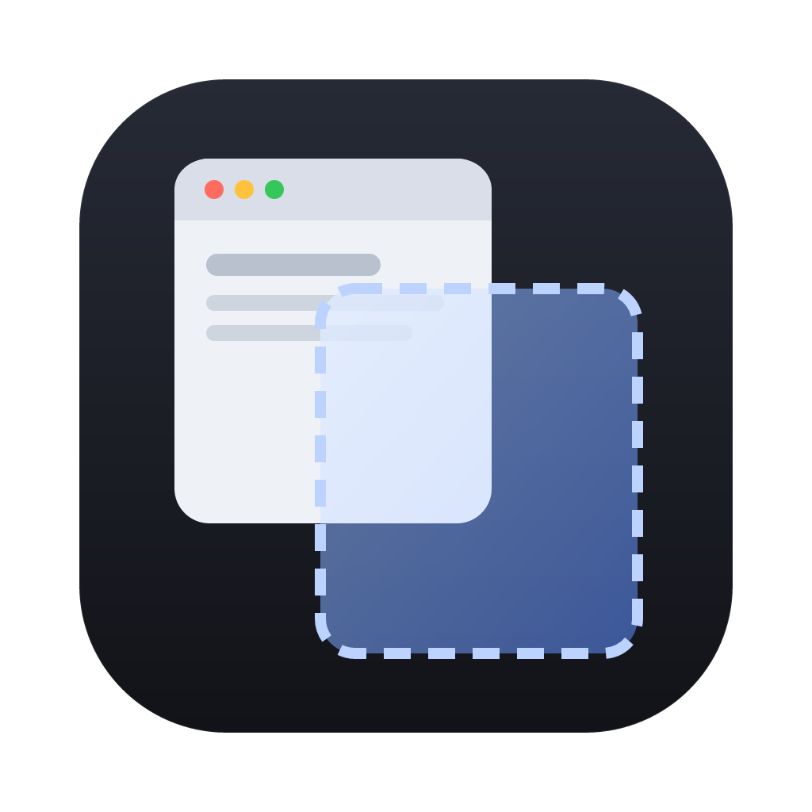

<p align="center">
  
</p>

<h1 align="center">Ghostframe</h1>

<p align="center">Check a website against its Figma design: side by side, overlaid, or swiped.</p>

---

Put the live page (localhost works) next to the Figma frame, lay the design over it as a see-through ghost, or swipe between them to spot every pixel that's off.

## Download

Get the latest build from [Releases](../../releases/latest):

| Platform | File |
| --- | --- |
| macOS (Apple Silicon) | `Ghostframe-x.y.z-mac-arm64.dmg` |
| Windows (x64) | `Ghostframe-x.y.z-win-x64.exe` |
| Linux (x64) | `Ghostframe-x.y.z-linux-x86_64.AppImage` |

The builds aren't signed with a paid certificate, so on first launch:

- **macOS:** if it says the app "is damaged" or "can't be opened", run `xattr -cr /Applications/Ghostframe.app` once.
- **Windows:** in the SmartScreen prompt, choose **More info → Run anyway**.
- **Linux:** `chmod +x Ghostframe-*.AppImage`, then run it.

## Features

- **Side by side, Overlay and Swipe** modes. Overlay has an opacity slider and a **Difference** blend mode, so matching pixels turn black and anything off stands out.
- **Pixel-exact Figma renders.** With a Figma personal access token, the app renders the exact frame through the Figma API, shown at its real size. Without a token it falls back to Figma's embed, or you can drop or paste a PNG export.
- **Any site can be framed.** The app removes `X-Frame-Options` and CSP `frame-ancestors` from iframe responses, so dev servers with security middleware (such as `nuxt-security`) load without a proxy.
- **Exact viewport width.** The site's scrollbar is hidden (scrolling still works), so the page lays out at exactly the width you choose.
- **Device presets** (Mobile 390, Tablet 768, Desktop 1440) or any custom width. **Full page** sizes the site to the design's height so both scroll together.
- **Alignment helpers:** offset X/Y with arrow-key nudging, and a choice of which layer receives clicks.

### Figma token (recommended)

1. In Figma, go to **Settings → Security → Personal access tokens** and create a token with read access to file content.
2. Paste it into the **Token** field. It's stored encrypted with the OS keychain in the app's data folder and never reaches the page.
3. Use a link to a specific frame: right-click the frame, then **Copy link to selection**. The link needs a `node-id`.

When a frame loads, the site width is set to match it.

### Keyboard

| Key | Action |
| --- | --- |
| `1` `2` `3` | Side by side, Overlay, Swipe |
| Arrow keys | Nudge the design layer by 1px (hold Shift for 10px) |
| `R` | Reload the site |
| `Enter` in a URL field | Load |

## Development

```bash
npm install
npm run dev        # run with hot reload
npm run typecheck
npm run dist       # build an installer for the current OS into dist/
```

The first run downloads the Electron binary.

| Path | Role |
| --- | --- |
| `src/main` | Electron main process: removes framing headers, calls the Figma API, stores the token |
| `src/preload` | Exposes a small `window.api` bridge to the app window. Inside the site iframe it only injects CSS that hides the scrollbar |
| `src/renderer` | The UI (plain TypeScript, no framework) |
| `src/shared` | Figma URL parsing and shared types |
| `build/` | App icon (`icon.svg` is the source, `icon.png` the 1024px render) |

## Releases

Releases are fully automatic. Every push to `main` runs [`release.yml`](.github/workflows/release.yml), which:

1. Picks the next version by bumping the patch number of the latest `v*` tag (`0.1.0`, `0.1.1`, `0.1.2`, …).
2. Builds the Linux AppImage, the Apple Silicon DMG and the Windows installer on their own runners.
3. Publishes a GitHub release with all three files attached, plus release notes generated from the commits.

Pushes that only change Markdown files don't trigger a release. To start a new minor or major version, set `version` in `package.json` (e.g. `0.2.0`) and the next release uses it. Pull requests and other branches only get a typecheck and build ([`ci.yml`](.github/workflows/ci.yml)).

## Limitations

- The site is a narrow desktop browser, not an emulated phone. It doesn't use a mobile user agent or touch events, so anything that depends on those won't show.
- Figma's embed shrinks and letterboxes frames. Use a token or an image export for pixel-accurate overlays.
- Images you drop in are stretched to the site width, because their export scale is unknown. Figma API renders are always shown at their true size.
